# Architecture

## Process composition

`main.go` parses the small CLI and builds the application with Fx. Configuration,
logging, health state, observability, selectors, protocol adapters, handlers,
and servers are constructed once at startup. All three protocol servers are
wired, but only the server matching `config.protocol` starts a listener.

The main packages have these responsibilities:

| Package | Responsibility |
| --- | --- |
| `internal/config` | YAML defaults, decoding, normalization, and validation |
| `internal/app` | dependency providers, logger, rate limiter, reload, socket activation, and Unix runtime isolation |
| `internal/server` | HTTP listener lifecycle |
| `internal/proxy` | HTTP ingress, policy, Primary response, detached Shadow work, and result logging |
| `internal/backend` | HTTP target selection and transport |
| `internal/pathrules` | ordered HTTP rule resolution |
| `internal/mapping` | direct or regex HTTP path mapping |
| `internal/grpcproxy` | generic gRPC listener, targets, rules, streams, comparison, OIDC, and logging |
| `internal/milterproxy` | Milter listener, client connections, Primary path, and per-connection Shadow worker |
| `internal/protocol` | shared event/result model plus HTTP and Milter adapters/comparators |
| `internal/compare` | HTTP header, JSON, and HTML comparators |
| `internal/observability` | Prometheus registry, OTLP providers, spans, metrics, and trace carriers |
| `internal/health` | local readiness state and handler |

## HTTP data path

The HTTP handler reads and bounds the request body, resolves a path rule, maps
Primary and Shadow paths, and prepares forwarding headers. It creates a Primary
session and returns the completed Primary response. Only then does it run a
selected Shadow request in a goroutine with a context detached from client
cancellation and bounded by `shadow_timeout`.

HTTP target selection and upstream transport live under `internal/backend`.
With failover enabled, the requester repeats an attempt only when the HTTP
transport never handed out a connection for its last internal try (tracked with
`httptrace`). For requests the transport itself may replay after sending (GET,
HEAD, OPTIONS, TRACE, or an `Idempotency-Key` header), any earlier connection
also makes the attempt final, because the transport's own replay may follow a
delivered request.
The protocol adapter owns request construction. The comparator registry allows
a rule to choose header, JSON, or HTML comparison per request.

## gRPC data path

The gRPC server uses a raw codec and an unknown-service handler, so it does not
need generated stubs or descriptors. It selects a Primary target, creates the
upstream stream, and forwards client and server messages. A Shadow forwarder
receives request messages through a bounded queue and collects only the state
needed by the configured comparator.

With failover enabled, only upstream stream creation is repeated. No client
message is read before the stream exists, and stream-creation errors precede
the request headers, so a repeated attempt can never execute a method twice.

The protocol-neutral attempt engine (candidate order, backoff, budget, and
passive cooldown) lives in `internal/failover`; the HTTP requester and the gRPC
target pools supply the protocol-specific safety classification.

The `least_conn` selection mode uses the in-flight counters of the same
package (`failover.Load`). A slot is held for exactly one running attempt: the
HTTP requester brackets `client.Do` and the response read, the gRPC pool holds
it from stream creation until the stream's release function runs. The target
is chosen immediately before the slot is taken; the gRPC pool therefore
decides when the stream is opened, not when the call is routed. Because an
unreachable target never holds a slot, such a pool always opens its attempts
through the engine, even with a disabled policy, so that connect failures
start the cooldown that keeps the target out of the first choice.

Primary response headers, messages, trailers, and status remain client-visible.
The Shadow stream is observed separately. OIDC token injection is a Primary
metadata concern and is applied before the Primary upstream call.

## Milter data path

The Milter listener creates one Primary backend session per accepted client
connection. Incoming frames are passed to Primary synchronously. Commands in
the fixed no-reply set perform only a write; option negotiation, EOM, and
unknown reply-turn commands also read a complete response sequence.

If Shadow is selected for the connection, a fixed-capacity worker queue
serializes frames onto one lazily opened Shadow session. Queue overflow or a
Shadow failure disables the worker for the rest of that connection.

## Protocol timing comparison

The three modes share the Primary safety boundary, but schedule Shadow work at
different points because their protocol lifecycles differ.

```mermaid
flowchart TB
    subgraph http["HTTP request"]
        h1["Read and validate request"] --> h2["Complete Primary request"]
        h2 --> h3["Prepare and return Primary response"]
        h3 --> h4["Run detached Shadow request"]
        h4 --> h5["Compare completed responses"]
    end

    subgraph grpc["gRPC stream"]
        g1["Open Primary stream"] --> g2["Forward messages to Primary"]
        g1 --> g3["Queue messages for Shadow"]
        g2 --> g4["Forward Primary responses"]
        g3 --> g5["Collect Shadow state or time out"]
        g4 --> g6["Finish RPC after bounded wait"]
        g5 --> g6
    end

    subgraph milter["Milter connection"]
        m1["Receive ordered frame"] --> m2["Complete synchronous Primary turn"]
        m2 --> m4["Return Primary reply when required"]
        m4 --> m3["Queue frame for one Shadow worker"]
        m3 --> m5["Preserve per-connection order"]
    end
```

For gRPC, final completion waits for Shadow only up to
`grpc_shadow_timeout`. The HTTP client does not wait for detached Shadow work,
and the Milter client waits only for the synchronous Primary exchange.

## Cross-cutting safety boundaries

- Rules and target selectors are deterministic after configuration is loaded.
- The token bucket is process-local and shared by the active protocol path.
- HTTP and gRPC detached Shadow contexts intentionally survive client
  cancellation but retain configured Shadow deadlines.
- Observability must never add fields to opaque Milter payloads.
- gRPC metadata overlays reject transport-reserved and binary keys.
- Result logs should contain bounded, selected comparison material rather than
  arbitrary request metadata or full gRPC messages.

## Lifecycle

The active protocol marks readiness after its listener and server state are
initialized. Listener failure marks it not ready and asks Fx to shut down.
Observability starts its own listener when enabled and flushes providers during
shutdown.

On Unix, SIGHUP validates configuration and re-executes the current binary.
Socket activation consumes file descriptors passed by systemd and selects them
by protocol name, expected port, or deterministic fallback.
